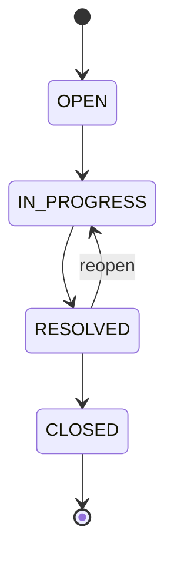
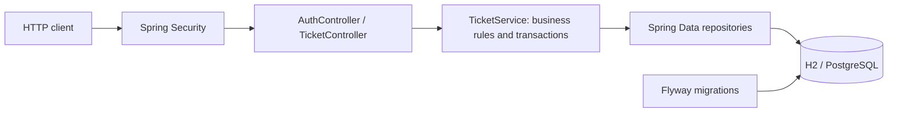

# Helpdesk API

[Português](README.md) | **English**

A support ticket REST API built as a back-end portfolio project with **Java 21, Spring Boot 4.1, Spring Security, Spring Data JPA and Flyway**.

Customers open tickets, follow their progress and add comments. Support agents manage the ticket lifecycle. Each status change creates an audit event in the same database transaction.

## Purpose

Practice a realistic business workflow with authentication, resource ownership, relational persistence and automated tests. The project shows how these concerns work together in a small application that can be demonstrated through HTTP requests.

## Features and business rules

- Public registration always creates a `CUSTOMER`; users cannot choose or promote their own role.
- Stateless HTTP Basic authentication and BCrypt password hashing; API responses never expose password hashes.
- Customers can only access their own tickets, comments and history. Other customers' resources return 404.
- Agents can view all tickets and are the only users allowed to change their status.
- Ticket filtering by status and priority, with paginated tickets and history (up to 100 records per page).
- Input validation and controller errors using Problem Details.
- Transactions keep status changes and audit events consistent.
- JPA `@Version` detects conflicting updates.
- Flyway owns schema migrations; Hibernate validates the schema without modifying it.



Closed tickets cannot receive comments or further status changes. Priorities: `LOW`, `MEDIUM`, `HIGH`, `URGENT`.

## Run locally

Install **JDK 21** and configure `JAVA_HOME`. The Maven Wrapper downloads Maven and dependencies on the first run, which requires internet access.

```bash
git clone https://github.com/GustavoBenAbraham/helpdesk-api.git
cd helpdesk-api
```

Windows PowerShell:

```powershell
.\mvnw.cmd spring-boot:run "-Dspring-boot.run.profiles=demo"
```

Linux/macOS:

```bash
chmod +x mvnw
./mvnw spring-boot:run -Dspring-boot.run.profiles=demo
```

The API listens at `http://localhost:8080`. Check `GET /actuator/health`. Local H2 data is persisted in `data/` and survives restarts.

The `demo` profile creates an agent with email `agente@demo.local` and password `DemoSenha123!`. These are public demonstration credentials. Use a separate database for demonstrations: disabling the profile does not delete an existing demo account.

Open [requests.http](requests.http) with the VS Code REST Client extension for an example workflow. There is no graphical interface or Swagger UI. API messages are currently in Portuguese.

### First requests

Run these examples in Bash:

```bash
curl -X POST http://localhost:8080/api/auth/register \
  -H 'Content-Type: application/json' \
  -d '{"name":"Maria","email":"maria@example.com","password":"MinhaSenha123!"}'

curl -u 'maria@example.com:MinhaSenha123!' \
  -H 'Content-Type: application/json' \
  -d '{"title":"Payment error","description":"Checkout returns HTTP 500","priority":"HIGH"}' \
  http://localhost:8080/api/tickets
```

## Endpoints

All endpoints require HTTP Basic authentication except registration and health.

| Method | Endpoint | Purpose / request fields |
| --- | --- | --- |
| POST | `/api/auth/register` | Register: `name`, `email`, `password` |
| GET | `/api/auth/me` | Current account |
| POST | `/api/tickets` | Create: `title`, `description`, `priority` |
| GET | `/api/tickets` | List: optional `status`, `priority`, `page`, `size` |
| GET | `/api/tickets/{id}` | Ticket details |
| PATCH | `/api/tickets/{id}/status` | Update: `{"status":"IN_PROGRESS"}` |
| POST | `/api/tickets/{id}/comments` | Comment: `{"message":"Additional details"}` |
| GET | `/api/tickets/{id}/history` | Event history: optional `page`, `size` |
| GET | `/actuator/health` | Application health |

Pages start at zero, with a default size of 20 and maximum size of 100. Ticket lists are ordered by creation time descending. Page responses contain `content`, `page`, `size`, `totalElements` and `totalPages`.

Status codes: `201` creation, `200` successful reads/updates, `400` invalid input, `401` missing/invalid credentials, `403` insufficient permissions, `404` missing/inaccessible resource and `409` duplicate email, invalid transitions or conflicting updates.

## Architecture



`ApiModels` defines request and response DTOs independently of JPA entities. `ApiErrors` handles controller errors. `TicketService` handles ownership checks, transitions and audit events. `Account`, `Ticket` and `TicketEvent` are the persisted entities. Registration uses the account repository directly because it is a small flow.

## What I practiced during development

This project is part of my preparation for a back-end development role. With AI tools assisting implementation, I am practicing reading the code, running the tests and explaining the technical decisions.

| Topic | Where it appears | Takeaway |
| --- | --- | --- |
| REST and HTTP | Controllers and response codes | Map operations to HTTP methods and distinguish validation, authentication, authorization and business errors. |
| Separation of responsibilities | Controllers, service and repositories | Keep business rules separate from HTTP handling and persistence. |
| Authentication vs. authorization | `SecurityConfig` and ownership checks | An authenticated user still needs permission to access each resource. |
| Password storage | BCrypt in `AuthController` | Store password hashes and keep credentials out of API responses. |
| Relational modeling | Accounts, tickets and events | Represent relationships with foreign keys and protect data integrity through constraints. |
| Business workflows | `TicketService.transition` | Encode allowed transitions explicitly, including reopening and terminal states. |
| Transactions and auditing | Status update and event insertion | Persist related changes together so history matches the ticket state. |
| Concurrency | `@Version` on `Ticket` | Learn how optimistic locking detects competing updates. A dedicated concurrency test is still pending. |
| Schema evolution | Flyway SQL migration | Version database changes instead of relying on automatic schema updates. |
| Integration testing | `ApiIntegrationTests` | Exercise real HTTP requests, including attempts to access another customer's data. |
| Build automation | Maven Wrapper and GitHub Actions | Make builds repeatable and run checks on pushes and pull requests. |

### Decisions and areas to explore further

- HTTP Basic keeps this MVP small while exposing authentication and authorization concepts. JWT is not implemented; OAuth2/OIDC is a possible future improvement.
- Persistent H2 simplifies local demonstrations. PostgreSQL should also be validated through Testcontainers.
- Pagination limits prevent unbounded list responses.
- DTOs keep API contracts independent of JPA entity serialization.
- Further work includes concurrency tests, password recovery, agent assignment and SLA tracking.

## Tests and build

```powershell
.\mvnw.cmd verify
```

On Linux/macOS, use `./mvnw verify`. The three integration tests start a real HTTP server on a random port with an isolated H2 database. They cover authentication, validation, duplicate registration, customer isolation, agent permissions, filtering, status transitions, reopening, closure and event history.

GitHub Actions runs `verify` with Java 21 on pushes and pull requests. Local H2 tests and JAR startup have been validated. PostgreSQL/Docker execution has not yet been validated in the development environment.

Build and run the JAR:

```powershell
.\mvnw.cmd package
java -jar target/helpdesk-0.0.1-SNAPSHOT.jar --spring.profiles.active=demo
```

## PostgreSQL with Docker

Install Docker with Compose, then run:

```powershell
Copy-Item .env.example .env
# Set DB_PASSWORD in .env before continuing.
docker compose up --build
```

On Linux/macOS, use `cp .env.example .env`. Compose starts the API and PostgreSQL with a persistent volume. The database port is not exposed to the host. The demo profile is off; for a local agent demonstration, add `SPRING_PROFILES_ACTIVE: demo` to the API service environment.

Without Docker, set `DB_URL=jdbc:postgresql://localhost:5432/helpdesk`, `DB_USER` and `DB_PASSWORD` before starting the application. HTTP Basic sends credentials with each request, so a public deployment needs HTTPS, rate limiting and an appropriate account-management flow.

## Interview walkthrough

1. Explain the support workflow and customer/agent roles.
2. Register two customers and show that one cannot read the other's ticket.
3. Create a ticket and comment; attempt a status update as a customer (403).
4. As an agent, attempt to close it directly (409), then follow the allowed transitions.
5. Show the event history and explain transactions, foreign keys and optimistic locking.
6. Run the tests and walk through the migration and CI workflow.

## Author

[Gustavo Ben Abraham Silva](https://github.com/GustavoBenAbraham)
