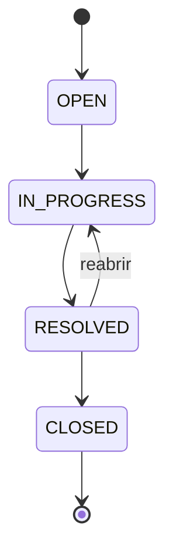
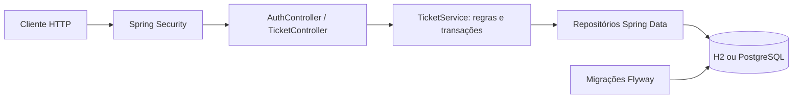

# Helpdesk API

**Português** | [English](README.en.md)

API de gestão de chamados de suporte desenvolvida para portfólio back-end com **Java 21, Spring Boot 4.1, Spring Security, Spring Data JPA e Flyway**.

Um cliente abre um chamado, acompanha o atendimento e adiciona comentários. Um agente atende os chamados e registra a evolução até o encerramento. Cada mudança de status gera um evento de auditoria na mesma transação.

## Executar localmente

Pré-requisito: **JDK 21** instalado e `JAVA_HOME` configurado. O Maven Wrapper baixa o Maven automaticamente na primeira execução; precisa de internet.

No PowerShell, na pasta do projeto:

```powershell
.\mvnw.cmd spring-boot:run "-Dspring-boot.run.profiles=demo"
```

No Linux/macOS:

```bash
chmod +x mvnw
./mvnw spring-boot:run -Dspring-boot.run.profiles=demo
```

A API fica em `http://localhost:8080`. Confira `GET /actuator/health`. O banco H2 persiste em `data/`, sem exigir instalação de banco. O perfil `demo` cria o agente `agente@demo.local` com senha `DemoSenha123!`. Esse usuário só é criado quando o perfil está ativo. Os dados permanecem no banco após desligar o perfil; use um banco separado para demonstração.

Abra [requests.http](requests.http) na extensão REST Client do VS Code para executar o roteiro completo. Também é possível importar os endpoints no Postman ou usar curl.

### Primeiro chamado com curl

No Windows use `curl.exe` ou execute os exemplos em um terminal Bash:

```bash
curl -X POST http://localhost:8080/api/auth/register \
  -H 'Content-Type: application/json' \
  -d '{"name":"Maria","email":"maria@example.com","password":"MinhaSenha123!"}'

curl -u 'maria@example.com:MinhaSenha123!' \
  -H 'Content-Type: application/json' \
  -d '{"title":"Erro no pagamento","description":"Pedido retorna erro 500","priority":"HIGH"}' \
  http://localhost:8080/api/tickets
```

## Funcionalidades e regras

- Cadastro público sempre cria um `CUSTOMER`; a API não permite escolher ou promover o próprio papel.
- Senhas com hash BCrypt; respostas nunca expõem o hash.
- Autenticação HTTP Basic sem sessão. As credenciais são enviadas a cada requisição autenticada. Em hospedagem pública, configure HTTPS e limites de requisições no proxy.
- Clientes acessam apenas seus próprios chamados, incluindo comentários e histórico. Recursos de outro cliente retornam 404.
- Agentes visualizam todos os chamados e são os únicos autorizados a mudar status.
- Filtros por status e prioridade, paginação de chamados e histórico (até 100 registros por página).
- Validação de entrada e erros no formato Problem Details nos controladores.
- Transações garantem que alteração de status e auditoria sejam persistidas juntas.
- `@Version` detecta atualizações concorrentes do mesmo chamado e retorna conflito.
- Migrações Flyway versionam o banco; Hibernate valida o esquema sem alterá-lo.



Chamados encerrados não aceitam comentários nem novas mudanças de status. Prioridades: `LOW`, `MEDIUM`, `HIGH`, `URGENT`.

## Endpoints

Todos os endpoints exigem HTTP Basic, exceto cadastro e saúde.

| Método | Rota | Função |
| --- | --- | --- |
| POST | `/api/auth/register` | Cadastro: `name`, `email`, `password` |
| GET | `/api/auth/me` | Usuário autenticado |
| POST | `/api/tickets` | Criar: `title`, `description`, `priority` |
| GET | `/api/tickets` | Listar com `status`, `priority`, `page`, `size` |
| GET | `/api/tickets/{id}` | Detalhar chamado |
| PATCH | `/api/tickets/{id}/status` | Alterar: `{"status":"IN_PROGRESS"}` |
| POST | `/api/tickets/{id}/comments` | Comentar: `{"message":"Detalhes do problema"}` |
| GET | `/api/tickets/{id}/history` | Histórico com `page`, `size` |
| GET | `/actuator/health` | Saúde da aplicação |

Paginação começa em zero; tamanho padrão 20. Listagem ordenada por criação decrescente. Resposta paginada: `content`, `page`, `size`, `totalElements`, `totalPages`.

Respostas principais: `201` criação, `200` consulta/alteração, `400` entrada inválida, `401` credenciais ausentes/inválidas, `403` papel insuficiente, `404` recurso não encontrado/sem acesso e `409` e-mail duplicado, transição inválida ou conflito de atualização.

## Arquitetura



`ApiModels` define contratos de entrada e saída independentes das entidades JPA. `ApiErrors` centraliza os erros dos controladores. `TicketService` concentra autorização por proprietário, transições e auditoria. As entidades `Account`, `Ticket` e `TicketEvent` formam o modelo persistido. O cadastro usa diretamente o repositório por ser um fluxo pequeno; um serviço separado passa a fazer sentido se houver verificação de e-mail ou outros passos.

## Testes e build

```powershell
.\mvnw.cmd verify
```

Os testes de integração sobem o servidor em porta aleatória e fazem requisições HTTP reais com banco H2 isolado. Cobrem autenticação, validação, duplicidade de cadastro, isolamento entre clientes, autorização de agente, filtros, transições, reabertura, encerramento e histórico. O GitHub Actions executa `verify` com Java 21 a cada push e pull request.

Para gerar e executar o JAR:

```powershell
.\mvnw.cmd package
java -jar target/helpdesk-0.0.1-SNAPSHOT.jar --spring.profiles.active=demo
```

## PostgreSQL com Docker

Pré-requisito: Docker com Compose.

```powershell
Copy-Item .env.example .env
# Edite DB_PASSWORD no arquivo .env antes de continuar.
docker compose up --build
```

O Compose sobe a API e o PostgreSQL com volume persistente. O perfil demo não é ativado nesse modo. Para uma demonstração local com agente, acrescente `SPRING_PROFILES_ACTIVE: demo` ao ambiente do serviço `api`. O banco não publica porta para a máquina host.

Sem Docker, configure `DB_URL=jdbc:postgresql://localhost:5432/helpdesk`, `DB_USER` e `DB_PASSWORD` antes de executar o JAR. O mesmo esquema Flyway é usado para H2 e PostgreSQL.

## Como apresentar em uma entrevista

1. Explique o problema de suporte e os dois papéis da aplicação.
2. Cadastre dois clientes; demonstre que um não acessa o chamado do outro.
3. Abra um chamado, adicione um comentário e tente uma alteração de status como cliente (403).
4. Como agente, tente encerrar diretamente (409), depois percorra o fluxo correto.
5. Mostre o histórico e explique a transação, as chaves estrangeiras e o controle de concorrência.
6. Execute os testes e mostre a migração do banco e a configuração de CI.

Este é um MVP de portfólio. Evoluções possíveis: autenticação via provedor OAuth2/OIDC, recuperação de senha, atribuição de responsável, SLA, notificações assíncronas e testes com PostgreSQL via Testcontainers. A versão atual não inclui interface gráfica ou Swagger UI; a demonstração usa o cliente HTTP. Os testes com H2 e a inicialização do JAR foram validados localmente; a execução com PostgreSQL/Docker ainda precisa de validação.

## Aprendizados durante o desenvolvimento

Este projeto faz parte dos meus estudos para uma oportunidade em desenvolvimento back-end. Com apoio de ferramentas de IA na implementação, estou praticando a leitura do código, a execução dos testes e a explicação das decisões técnicas.

| Conceito praticado | Aplicação neste projeto | O que aprendi com o exemplo |
| --- | --- | --- |
| API REST e HTTP | Endpoints e códigos de resposta | Relacionar operações a métodos HTTP e diferenciar erros de validação, autenticação, acesso e regras de negócio. |
| Separação de responsabilidades | Controladores, serviço e repositórios | Manter regras de negócio fora dos endpoints e separar persistência dos contratos da API. |
| Autenticação e autorização | `SecurityConfig` e verificação de proprietário | Identificar um usuário não significa permitir acesso a qualquer recurso; papel e propriedade também precisam ser verificados. |
| Proteção de senhas | BCrypt em `AuthController` | Armazenar hash de senha e evitar expor credenciais nas respostas da API. |
| Modelagem relacional | Contas, chamados e eventos | Representar relacionamentos com chaves estrangeiras e usar restrições para preservar a integridade dos dados. |
| Regras de negócio | `TicketService.transition` | Validar transições explicitamente, incluindo reabertura e bloqueio após encerramento. |
| Transações e auditoria | Alteração de status e evento na mesma transação | Evitar persistir uma mudança sem o registro correspondente no histórico. |
| Concorrência | `@Version` em `Ticket` | Conhecer o bloqueio otimista para detectar atualizações concorrentes. Esse cenário ainda não tem teste específico. |
| Migrações | SQL versionado com Flyway | Evoluir a estrutura do banco por migrações e deixar o Hibernate validar o esquema. |
| Testes de integração | `ApiIntegrationTests` com HTTP real | Verificar o comportamento completo, especialmente tentativas de acesso aos dados de outro cliente. |
| Automação e configuração | Maven Wrapper, GitHub Actions e variáveis de ambiente | Tornar o build reproduzível e separar configuração de banco do código. |

### Decisões e pontos que quero aprofundar

- Usei HTTP Basic para simplificar o MVP e estudar autenticação e autorização antes de adicionar OAuth2/OIDC. A aplicação não implementa JWT.
- Usei H2 persistente para facilitar a demonstração local. Quero validar PostgreSQL com Testcontainers para testar diferenças entre bancos.
- Limitei a paginação a 100 registros por página para evitar respostas sem limite.
- Usei DTOs para definir respostas sem serializar diretamente as entidades JPA.
- Quero adicionar testes de concorrência, recuperação de senha e atribuição de agentes.

## Autor

[Gustavo Ben Abraham Silva](https://github.com/GustavoBenAbraham)
